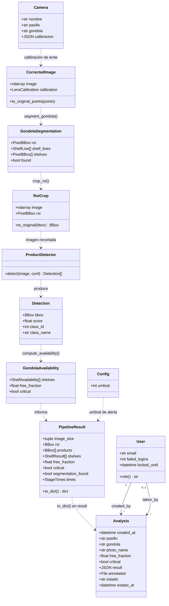
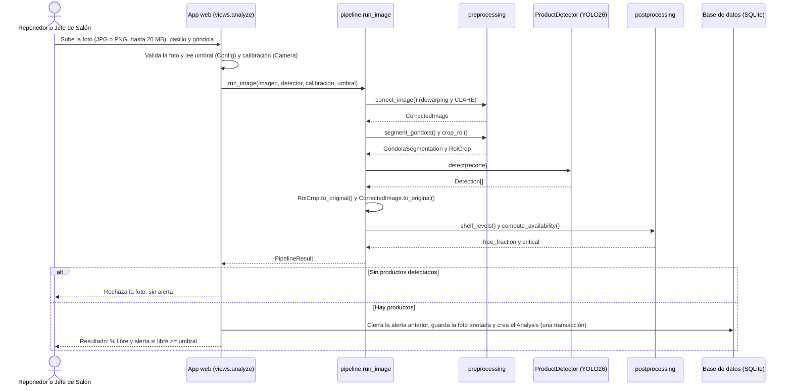
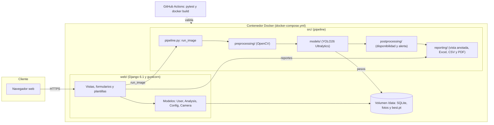

# Diagramas UML

Diagramas de **clases**, **secuencia** y **componentes** del sistema, hechos desde el código real (`src/`, `web/`) al 2026-11-14. Están en Mermaid: GitHub los dibuja en esta misma página. Imágenes (con su fuente en `Diagramas fuente (Mermaid)/`): [clases](Diagrama%20de%20Clases.png), [secuencia](Diagrama%20de%20Secuencia%20-%20Analisis%20de%20una%20foto.png) y [componentes](Diagrama%20de%20Componentes.png). Se generan con el comando de `Diagramas fuente (Mermaid)/LEEME.md`. Los diagramas de casos de uso están en [Diagrama General Casos de Uso.png](Diagrama%20General%20Casos%20de%20Uso.png) y en `Diagramas particulares por cada C. U._/`; la arquitectura, en [Diagrama de Arquitectura.png](Diagrama%20de%20arquitectura/Diagrama%20de%20Arquitectura.png).

## 1. Diagrama de clases

Las estructuras del pipeline son `dataclass` inmutables que las etapas se pasan entre sí (regla "pipeline modular" de `CLAUDE.md`); los modelos de la aplicación web son los de Django (`web/models.py`).

## 2. Diagrama de secuencia: análisis de una foto (CU01 y CU02)

## 3. Diagrama de componentes

