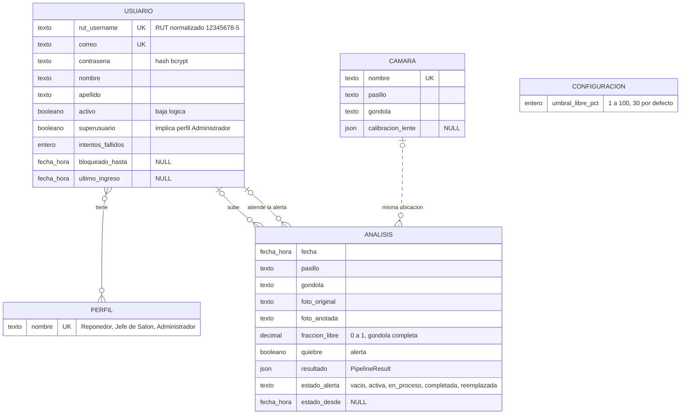
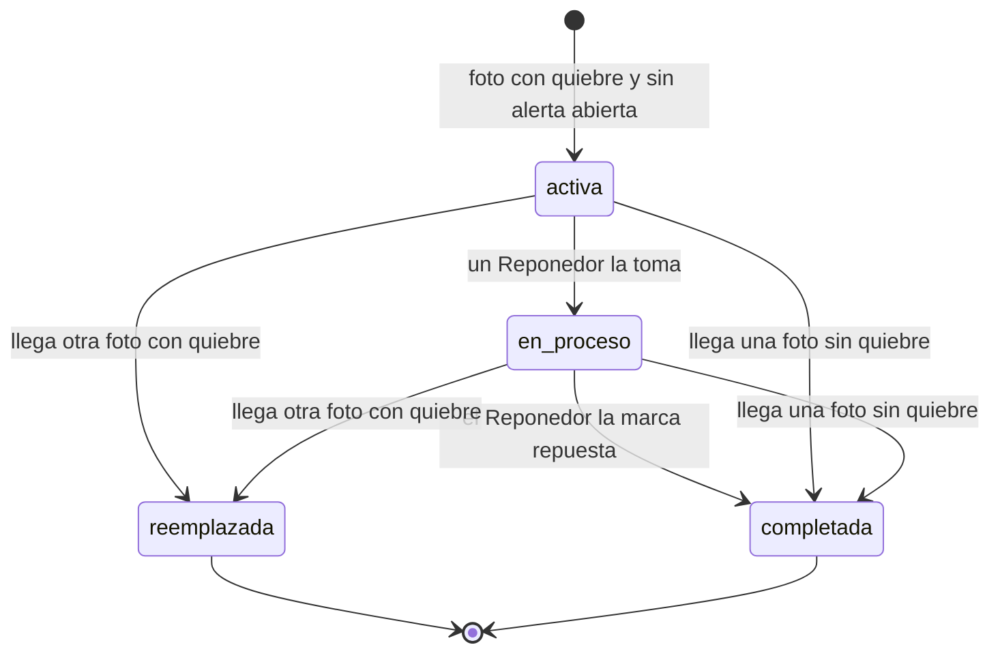

# Modelo lógico de datos - ShelfVision AI

Modelo lógico de la base de datos de la aplicación web (Django + SQLite).
Describe **qué información guarda el sistema y cómo se relaciona**, sin
entrar en tipos físicos ni nombres de índices (eso es el
[Modelo Relacional](Modelo%20Relacional.md)). Cada campo está descrito en el
[Diccionario de Datos](Diccionario%20de%20Datos.md).

- **Corte**: 2026-11-15, `main` después del PR #103.
- **Fuente de verdad**: `web/models.py` y las migraciones `web/migrations/0001` a
  `0007`. Este documento reemplaza al `Modelo Logico.pdf` anterior, que no
  incluía `Config`, `Camera` ni `User.locked_until` (ítem #48).
- **Qué no guarda la base**: productos, SKU, imágenes de las cámaras ni
  detecciones sueltas. El detector no identifica productos (una sola clase) y
  el resultado completo de cada foto vive como un JSON dentro del análisis.
  Los pasillos y las góndolas **no son entidades**: son el par de textos
  `pasillo` y `gondola` que llevan las cámaras y los análisis.

## 1. Entidades

| Entidad | Tabla | Qué representa | Caso de uso |
| --- | --- | --- | --- |
| **Usuario** | `web_user` | Persona con cuenta. Se entra con RUT o correo; el perfil sale de su grupo | CU00, CU06 |
| **Perfil** | `auth_group` | Uno de los tres roles: Reponedor, Jefe de Salón y Administrador (los crea la migración `0002_roles`) | CU00, CU06 |
| **Análisis** | `web_analysis` | Una foto de góndola analizada con el pipeline: % libre, alerta de quiebre, resultado completo y, si hay quiebre, el estado de su alerta | CU01, CU02, CU03, CU04 |
| **Cámara** | `web_camera` | Cámara de sala asociada a un pasillo y una góndola, con su calibración de lente opcional | CU05 |
| **Configuración** | `web_config` | Parámetros de la tienda. Hoy solo el umbral de espacio libre. Una sola fila | CU05 |

Tablas del framework (Django las crea y la aplicación no las modifica):
`auth_permission`, `auth_group_permissions`, `web_user_user_permissions`,
`django_content_type`, `django_session` y `django_migrations`. Los permisos
de Django no se usan: **el rol se deriva del grupo** (`User.role`).

## 2. Diagrama entidad-relación lógico

La relación **Cámara - Análisis** es lógica, no una llave foránea: se unen por
el par (pasillo, góndola) y sin distinguir mayúsculas
(`Camera.objects.filter(pasillo__iexact=..., gondola__iexact=...)`). Un
análisis puede existir sin cámara (foto subida a mano) y una cámara puede no
tener análisis todavía.

## 3. Relaciones y cardinalidades

| Relación | Cardinalidad | Detalle |
| --- | --- | --- |
| Usuario - Perfil | N a M en la base, **1 a 1 en la práctica** | La tabla intermedia `web_user_groups` permite varios, pero el formulario de CU06 asigna un solo perfil y `User.role` toma el primero. Un superusuario es siempre Administrador |
| Usuario - Análisis (`created_by`) | 1 a N, opcional | Quién subió la foto. Es `NULL` si la subió la cámara simulada (`simular_camara`, #58). Si el usuario se borrara, el análisis queda con `NULL` (los usuarios no se borran: se desactivan) |
| Usuario - Análisis (`taken_by`) | 1 a N, opcional | Reponedor que tomó la alerta. `NULL` mientras está activa o si el análisis no tiene alerta |
| Cámara - Análisis | 0..1 a N, lógica | Por pasillo y góndola. Una sola cámara por góndola (restricción `una_camara_por_gondola`) |
| Configuración | Sin relaciones | Fila única (`id = 1`, `Config.get()`) |

## 4. Reglas de negocio que el modelo hace cumplir

1. **Identidad del usuario**: el RUT (`username`) se guarda sin puntos y en
   mayúsculas, con dígito verificador válido por módulo 11, y el correo es
   único porque también es credencial (CU00). Una cuenta creada con
   `createsuperuser` o desde el shell puede usar otro nombre de usuario: la
   validación del RUT vive en los formularios, no en la base.
2. **Baja lógica**: los usuarios no se borran, se desactivan (`is_active = 0`),
   para no perder quién hizo cada análisis. Las sesiones de una cuenta inactiva
   (o bloqueada) dejan de valer en la siguiente petición.
3. **Bloqueo por intentos fallidos** (#51): a los 5 intentos fallidos seguidos
   `failed_logins` vuelve a 0 y `locked_until` queda 15 minutos adelante. La
   cuenta **no se desactiva**: se desbloquea sola o el Administrador la
   desbloquea al guardarla en «Editar».
4. **Ubicación normalizada** (#49): `pasillo` y `gondola` se guardan sin
   espacios y en mayúsculas, así «a1» y «A1» son la misma góndola.
5. **Una alerta abierta por góndola** (CU02), mantenida por la aplicación en
   una transacción: solo un análisis por (pasillo, góndola) puede estar en
   `activa` o `en_proceso`.
6. **Quiebre por góndola completa** (#40): `free_fraction` y `critical` son los
   de la góndola entera. Las repisas son geometría dentro del JSON `result`,
   sin porcentaje ni alerta propios.
7. **Umbral configurable** (CU05): `critical` se calcula con el umbral vigente al
   analizar (`Config.umbral / 100`, por defecto 30 %). Un cambio del umbral
   rige para las fotos siguientes: lo ya analizado no se recalcula.
8. **Una cámara por góndola**: la pareja (pasillo, góndola) es única en
   `web_camera`, y el nombre de la cámara también.
9. **Privacidad de las fotos** (RNF05, #45): `borrar_fotos --dias N` borra el
   archivo de `annotated` y deja su campo vacío; el resto del análisis (%
   libre, alerta, estado e historial) se conserva.
10. **Foto sin resultado válido no se guarda**: sin productos detectados (#52) o
    con la góndola tapada por más de 50 % (#77) el análisis se rechaza y no
    toca la alerta abierta.

### Ciclo de vida de la alerta (`Análisis.estado`)

El análisis nace con `estado` vacío si no hay quiebre. Con quiebre, su alerta
recorre estos estados:

- Una foto nueva **con quiebre** convierte la alerta abierta en `reemplazada`;
  el análisis nuevo hereda su estado, quién la atiende (`taken_by`) y su
  `estado_at`. Si no había alerta abierta, nace `activa`.
- Una foto nueva **sin quiebre** cierra la alerta abierta como `completada`: es
  la confirmación de que se repuso.
- «Tomar» solo funciona desde `activa` y «Completar» solo desde `en_proceso`;
  si otra acción cambió el estado antes, no se reabre nada (#49).

### Estado de una góndola en el dashboard (CU03)

No se guarda: se calcula con el último análisis de cada góndola y el umbral.

| Estado | Condición |
| --- | --- |
| Quiebre | La última foto tiene `critical` |
| En riesgo | `free_fraction` sobre la mitad del umbral, sin llegar a alerta |
| Disponible | `free_fraction` bajo la mitad del umbral |
| Sin datos | No hay foto en las últimas 24 horas, o la góndola es de una cámara sin fotos |

## 5. Qué cambió respecto del modelo lógico anterior

| Cambio | Origen |
| --- | --- |
| Nueva entidad **Cámara** (`web_camera`) con calibración de lente y restricción de una cámara por góndola | #44, migración `0004` |
| Nueva entidad **Configuración** (`web_config`), fila única con el umbral | #44, migración `0004` |
| `Usuario.locked_until` y bloqueo temporal en vez de desactivar la cuenta | #51, migración `0006` |
| `Análisis` con `pasillo`, `gondola`, `estado`, `taken_by` y `estado_at` (ciclo de la alerta) | #28 y #43, migración `0003` |
| Normalización de `pasillo` y `gondola` (mayúsculas, sin espacios) | #49, migración `0005` |
| `critical` ya no vale «free_fraction >= 0,30» fijo: depende del umbral configurado | #44 |
| El JSON `result` suma `occluders`, `occluded_fraction` e `inconclusive` | #77 |
| `Análisis.annotated` puede quedar vacío tras `borrar_fotos` | #45 |
| Sin porcentaje ni alerta por repisa en `result.shelves` | #40 |

## 6. Mejoras posibles (no implementadas)

- **Pasillos y góndolas como entidades** (`PRODUCT.md` lo lista como
  pendiente): reemplazarían los dos textos repetidos en `web_camera` y
  `web_analysis` por una clave foránea.
- **Varias cámaras por góndola**: hoy la restricción `una_camara_por_gondola`
  lo impide.
- **Cámara del análisis**: guardar `camera_id` en el análisis en vez de unir por
  texto.
- **Historial del umbral**: guardar con qué umbral se calculó cada alerta
  (hoy solo queda `critical`).
