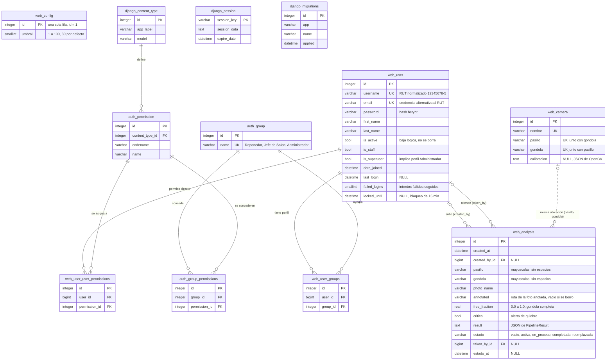

# Modelo relacional de datos - ShelfVision AI

Esquema físico de la base de datos de la aplicación web: 12 tablas en SQLite 3,
generadas por Django (`python manage.py migrate`). Se deriva del
[Modelo Lógico](Modelo%20Logico.md); cada columna está descrita en el
[Diccionario de Datos](Diccionario%20de%20Datos.md).

- **Corte**: 2026-11-15, `main` después del PR #103.
- **Fuente de verdad**: `web/models.py`, las migraciones `web/migrations/0001` a
  `0006` y el esquema real que crea `migrate` (el script `shelfvision.sql` es
  idéntico; `tests/test_sql_script.py` comprueba que coincidan). Este documento
  reemplaza al `Modelo Relacional.docx` anterior, que no tenía `web_config`,
  `web_camera` ni `locked_until` (ítem #48).
- **Tipos**: Django declara las llaves como `BigAutoField`, pero SQLite las
  guarda como `integer PRIMARY KEY AUTOINCREMENT`; por eso las llaves foráneas
  hacia `web_user` figuran como `bigint` y las demás como `integer`. En SQLite
  es lo mismo (64 bits).
- **Crear la base**: `python manage.py migrate` (la crea en
  `data/processed/web/db.sqlite3`) o `sqlite3 shelfvision.db < shelfvision.sql`
  (estructura más datos de prueba ficticios).

## 1. Diagrama del esquema

Fuente en `Fase 2/Evidencias Proyecto/Evidencias de documentación/Diseño/Diagramas fuente (Mermaid)/Diagrama Entidad-Relacion.mmd`.

La línea punteada entre `web_camera` y `web_analysis` es una relación **lógica**
por (`pasillo`, `gondola`), sin llave foránea. `django_session` y
`django_migrations` no se relacionan con otras tablas.

## 2. Esquemas de relación

Notación: **PK** llave primaria, `FK` llave foránea (`→ tabla(columna)`), `UK`
única, `NULL` admite nulos. Todo lo demás es `NOT NULL`.

**Tablas de la aplicación**

- `web_user`(**id**, password, last_login `NULL`, is_superuser, username `UK`,
  first_name, last_name, is_staff, is_active, date_joined, email `UK`,
  failed_logins, locked_until `NULL`)
- `web_analysis`(**id**, created_at, photo_name, free_fraction, critical, result,
  annotated, pasillo, gondola, estado, estado_at `NULL`,
  created_by_id `FK → web_user(id) NULL`, taken_by_id `FK → web_user(id) NULL`)
- `web_camera`(**id**, nombre `UK`, pasillo, gondola, calibracion `NULL`,
  `UK(pasillo, gondola)`)
- `web_config`(**id**, umbral)

**Perfiles y permisos (Django)**

- `auth_group`(**id**, name `UK`)
- `web_user_groups`(**id**, user_id `FK → web_user(id)`,
  group_id `FK → auth_group(id)`, `UK(user_id, group_id)`)
- `auth_permission`(**id**, content_type_id `FK → django_content_type(id)`,
  codename, name, `UK(content_type_id, codename)`)
- `auth_group_permissions`(**id**, group_id `FK → auth_group(id)`,
  permission_id `FK → auth_permission(id)`, `UK(group_id, permission_id)`)
- `web_user_user_permissions`(**id**, user_id `FK → web_user(id)`,
  permission_id `FK → auth_permission(id)`, `UK(user_id, permission_id)`)
- `django_content_type`(**id**, app_label, model, `UK(app_label, model)`)

**Soporte de Django**

- `django_session`(**session_key**, session_data, expire_date)
- `django_migrations`(**id**, app, name, applied)

## 3. Restricciones

### Llaves únicas

| Tabla | Restricción | Columnas |
| --- | --- | --- |
| `web_user` | `username` único | `username` |
| `web_user` | `email` único | `email` |
| `auth_group` | nombre de perfil único | `name` |
| `web_camera` | nombre único | `nombre` |
| `web_camera` | `una_camara_por_gondola` | `pasillo`, `gondola` |
| `web_user_groups` | un perfil no se repite por usuario | `user_id`, `group_id` |
| `web_user_user_permissions` | permiso no repetido por usuario | `user_id`, `permission_id` |
| `auth_group_permissions` | permiso no repetido por grupo | `group_id`, `permission_id` |
| `auth_permission` | código único por tipo de contenido | `content_type_id`, `codename` |
| `django_content_type` | modelo único por aplicación | `app_label`, `model` |

### Llaves foráneas

| Desde | Hacia | ¿Admite NULL? | Acción al borrar (la aplica el ORM de Django) |
| --- | --- | --- | --- |
| `web_analysis.created_by_id` | `web_user.id` | Sí | `SET_NULL` |
| `web_analysis.taken_by_id` | `web_user.id` | Sí | `SET_NULL` |
| `web_user_groups.user_id` | `web_user.id` | No | `CASCADE` |
| `web_user_groups.group_id` | `auth_group.id` | No | `CASCADE` |
| `web_user_user_permissions.user_id` | `web_user.id` | No | `CASCADE` |
| `web_user_user_permissions.permission_id` | `auth_permission.id` | No | `CASCADE` |
| `auth_group_permissions.group_id` | `auth_group.id` | No | `CASCADE` |
| `auth_group_permissions.permission_id` | `auth_permission.id` | No | `CASCADE` |
| `auth_permission.content_type_id` | `django_content_type.id` | No | `CASCADE` |

Todas se declaran `DEFERRABLE INITIALLY DEFERRED` y **sin cláusula `ON DELETE`**
en el DDL: `SET_NULL` y `CASCADE` los ejecuta el ORM de Django, no SQLite. Borrar
una fila con SQL directo no propaga el efecto. En la práctica los usuarios no se
borran (baja lógica) y los análisis tampoco.

### Restricciones `CHECK`

| Tabla | Condición | Qué asegura |
| --- | --- | --- |
| `web_user` | `failed_logins >= 0` | El contador de intentos no es negativo |
| `web_config` | `umbral >= 0` | `PositiveSmallIntegerField`; el rango real 1 a 100 lo valida la aplicación (`ConfigForm`, CU05) |
| `web_analysis` | `JSON_VALID(result) OR result IS NULL` | `result` es JSON válido |
| `web_camera` | `JSON_VALID(calibracion) OR calibracion IS NULL` | `calibracion` es JSON válido o nula |

Lo que **no** aplica la base y sí la aplicación: RUT con dígito verificador,
`pasillo` y `gondola` en mayúsculas y sin espacios, `free_fraction` entre 0 y 1,
`estado` dentro de sus cinco valores, una sola alerta abierta por góndola y el
formato de la calibración de lente.

## 4. Índices

Todos los crea Django. Los nombres llevan un sufijo hexadecimal que depende de
la versión de Django.

| Tabla | Índice | Columnas | Tipo |
| --- | --- | --- | --- |
| `web_analysis` | `web_analysis_created_by_id_9f0a4d4e` | `created_by_id` | Simple |
| `web_analysis` | `web_analysis_taken_by_id_f078d3b4` | `taken_by_id` | Simple |
| `web_user_groups` | `web_user_groups_user_id_ddeacfa4` | `user_id` | Simple |
| `web_user_groups` | `web_user_groups_group_id_b03a95c5` | `group_id` | Simple |
| `web_user_groups` | `web_user_groups_user_id_group_id_ad6e87b6_uniq` | `user_id`, `group_id` | Único |
| `web_user_user_permissions` | `..._user_id_19dddb18`, `..._permission_id_360139a1` | cada FK | Simple |
| `web_user_user_permissions` | `..._user_id_permission_id_b62696d3_uniq` | `user_id`, `permission_id` | Único |
| `auth_group_permissions` | `..._group_id_b120cbf9`, `..._permission_id_84c5c92e` | cada FK | Simple |
| `auth_group_permissions` | `..._group_id_permission_id_0cd325b0_uniq` | `group_id`, `permission_id` | Único |
| `auth_permission` | `..._content_type_id_2f476e4b` | `content_type_id` | Simple |
| `auth_permission` | `..._content_type_id_codename_01ab375a_uniq` | `content_type_id`, `codename` | Único |
| `django_content_type` | `..._app_label_model_76bd3d3b_uniq` | `app_label`, `model` | Único |
| `django_session` | `django_session_expire_date_a5c62663` | `expire_date` | Simple |

Además, cada `UNIQUE` y cada `PRIMARY KEY` crea su propio índice implícito
(`web_user.username`, `web_user.email`, `web_camera.nombre`,
`web_camera(pasillo, gondola)`, `auth_group.name`).

**Observación**: ninguna consulta de la aplicación tiene un índice propio por
(`pasillo`, `gondola`, `estado`) en `web_analysis`. Con el volumen esperado
(una tienda, una foto por análisis) SQLite lo resuelve sin problema; si el
historial crece, es el primer índice a evaluar. No se agregó.

## 5. Normalización

| Forma | Estado | Comentario |
| --- | --- | --- |
| 1FN | Cumple, con dos excepciones deliberadas | `web_analysis.result` y `web_camera.calibracion` guardan un JSON. El resultado del pipeline (cajas, repisas, huecos, tiempos) se escribe y se lee completo, nunca se consulta por pedazos, y normalizarlo sumaría miles de filas por foto. La calibración es el formato de OpenCV (`LensCalibration`) y se pasa entera al pipeline |
| 2FN | Cumple | Todas las llaves primarias son simples (un `id`) |
| 3FN | Cumple, con redundancia deliberada | `free_fraction` y `critical` se pueden derivar de `result` y del umbral vigente al analizar, pero se guardan aparte para filtrar, ordenar y reportar sin abrir el JSON. `pasillo` y `gondola` se repiten en `web_camera` y `web_analysis` porque no hay tabla de góndolas (ver «Mejoras posibles» del modelo lógico) |

## 6. Historial de migraciones

La aplicación `web` suma seis migraciones sobre las tablas de `auth`,
`contenttypes` y `sessions` de Django.

| Migración | Qué hace | Ítem |
| --- | --- | --- |
| `0001_initial` | Crea `web_user` (con `failed_logins`), `web_analysis` y las tablas intermedias de grupos y permisos del usuario | #28 |
| `0002_roles` | Inserta los tres perfiles en `auth_group` | #28 |
| `0003_ubicacion_y_estado` | Agrega a `web_analysis` `pasillo`, `gondola`, `estado`, `taken_by_id` y `estado_at`, y marca como `activa` las alertas críticas que ya existían | #28, #43 |
| `0004_configuracion_y_camaras` | Crea `web_config` y `web_camera` | #44 |
| `0005_normalizar_ubicacion` | Migración de datos: pasa `pasillo` y `gondola` a mayúsculas y sin espacios | #49 |
| `0006_bloqueo_por_tiempo` | Agrega `web_user.locked_until` | #51 |

## 7. Datos que trae la base recién creada

- **`auth_group`**: 3 filas (`Reponedor`, `Jefe de Salón`, `Administrador`), por la
  migración `0002`.
- **`web_config`**: se crea con `umbral = 30` la primera vez que se pide
  `Config.get()`. El script `shelfvision.sql` ya la trae.
- Todo lo demás parte vacío: el primer Administrador se crea con
  `python manage.py createsuperuser`. El script `shelfvision.sql` agrega 4
  usuarios, 3 cámaras y 6 análisis ficticios (la clave de los usuarios de
  prueba está en la cabecera del script).
